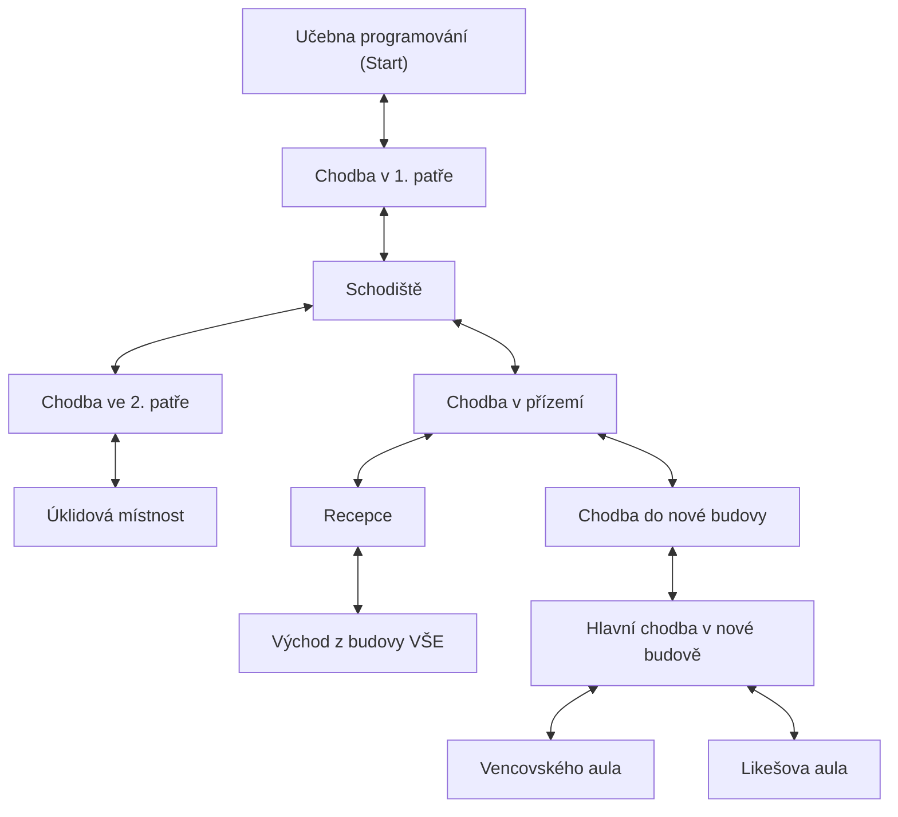

# Zadání a plánek hry: Přežij na VŠE

## Popis a cíl hry
Hra se odehrává v kampusu Vysoké školy ekonomické (VŠE). Hráč začíná v učebně informatiky (programování) ihned po skončení náročné přednášky z předmětu **4IT101**. Hráč trpí extrémní dehydratací a žízní, přičemž jeho hlavním úkolem je najít zdroj pitné vody, napít se a následně se včas dostavit na další povinnou přednášku z ekonomie, která se koná v Likešově aule.

Hra má limit **35 tahů**. Pokud hráč do té doby neuspokojí svou žízeň a neusadí se na správné přednášce, hra končí neúspěchem.

### Možné konce hry (Scénáře):
1. **Výhra (Good Ending)**: Hráč se napije vody a usedne na volné místo v Likešově aule (příkazy `pij` a následně `sedni` v Likešově aule).
2. **Chaotická výhra (Chaotic Ending)**: Hráč získá pití tím, že rozbije automat páčidlem, napije se a stihne přednášku. Hra končí vítězstvím, ale s komentářem o vandalství.
3. **Prohra - žízeň (Bad Ending)**: Hráč dorazí na přednášku a sedne si, aniž by uhasil žízeň. Zkolabuje z dehydratace.
4. **Prohra - špatná místnost (Bad Ending)**: Hráč si sedne na přednášce ve Vencovského aule místo Likešovy auly.
5. **Prohra - otrava (Bad Ending)**: Hráč naplní lahev od Sava vodou, vypije ji a otráví se.
6. **Prohra - časový limit (Bad Ending)**: Hráč vyčerpá všech 35 tahů a zmešká přednášku.
7. **Prohra - útěk ze školy (Chaotic Ending / Odchod)**: Hráč odejde z VŠE přes východ (vychod_z_VSE), čímž vzdá studium.

---

## Plánek místností (Herní plán)
Následující diagram znázorňuje všechny prostory (místnosti) a jejich vzájemné propojení:

---

## Přehled předmětů (Věcí)
Předměty ve hře mohou být buď přenositelné (lze je vložit do batohu), nebo statické (automat, sedačka). Hráčův batoh má **maximální kapacitu 5 věcí** a **maximální nosnost 6 jednotek hmotnosti**.

| Název předmětu | Přenositelnost | Hmotnost | Výchozí lokace | Popis / Použití |
| :--- | :---: | :---: | :--- | :--- |
| **učebnice_ekonomie** | Ano | 3 | chodba_1_patro | Slouží k výměně s Dominikem. |
| **páčidlo** | Ano | 5 | uklidova_mistnost | Lze jím rozbít automat. |
| **prázdná_lahev_od_Sava** | Ano | 1 | uklidova_mistnost | Lze naplnit vodou z automatu (otrava). |
| **mince** | Ano | 1 | chodba_prizemi, auly | Slouží k nákupu v nápojovém automatu. |
| **LOKNI_SI_automat** | Ne | 100 | chodba_do_nove_budovy | Umožňuje bezplatné natočení vody do lahve pomocí aplikace v mobilu. |
| **nápojový_automat** | Ne | 100 | chodba_v_nove_budove | Prodává nápoj za mince. |
| **volná_sedačka** | Ne | 50 | auly | Umožňuje posadit se na konci hry (`sedni`). |
| **telefon_s_aplikací_lokni_si** | Ano | 1 | Získává se od NPC | Umožňuje plnit lahve u LOKNI SI automatu. |
| **prázdná_lahev** | Ano | 1 | Získává se od NPC | Lze ji naplnit vodou z automatu. |
| **nápoj** | Ano | 2 | Automat / po rozbití | Uhasí žízeň. |
| **plná_lahev** | Ano | 2 | Naplněná lahev | Uhasí žízeň. |
| **plná_lahev_od_Sava** | Ano | 2 | Naplněná lahev od Sava | Způsobí otravu. |

---

## Přehled postav (NPC)
| Jméno postavy | Výchozí lokace | Popis a chování |
| :--- | :--- | :--- |
| **učitel** | ucebna_programovani | Připomíná studentům datum odevzdání semestrální práce. |
| **týpeček** | chodba_1_patro | Náhodný člověk, který ve škole ani nestuduje a neporadí. |
| **učitelka_ekonomie** | schodiste | Prozradí, že další přednáška se koná v Likešově aule. |
| **vrátný** | recepce | Poradí, kde se nacházejí nápojové automaty. |
| **student** | vencovskeho_aula | Čeká na přednášku z databází. |
| **studentka** | likesova_aula | Čeká na přednášku z ekonomie. |
| **Dominik** | chodba_2_patro | Vymění učebnici ekonomie za prázdnou lahev. |
| **Spolužačka** | chodba_prizemi | Půjčí telefon s aplikací LOKNI SI, pokud má hráč lahev na vodu. Po naplnění chce telefon zpět. |

---

## Herní příkazy
- `jdi <prostor>` – Přesune hráče do sousedního prostoru.
- `seber <předmět>` – Zvedne předmět a uloží do batohu (pokud unese).
- `polož <předmět>` – Položí předmět z batohu do místnosti.
- `vypiš <prostor/batoh>` – Vypíše aktuální obsah prostoru nebo batohu.
- `prozkoumej <předmět/prostor>` – Zobrazí detailní informace.
- `kup <předmět>` – Koupí nápoj v automatu za minci.
- `naplň <lahev>` – Naplní lahev vodou z automatu LOKNI SI (vyžaduje telefon s aplikací).
- `pij <nápoj>` – Vypije nápoj a zahání žízeň.
- `promluv <postava>` – Zahájí rozhovor s postavou.
- `rozbij <automat>` – Rozbije automat pomocí páčidla (získá nápoj bez mincí).
- `sedni` – Sedne si na sedačku (ukončí hru v aule).
- `log` – Vypíše historii příkazů a odpovědí.
- `nápověda` – Zobrazí nápovědu.
- `konec` – Ukončí hru.
